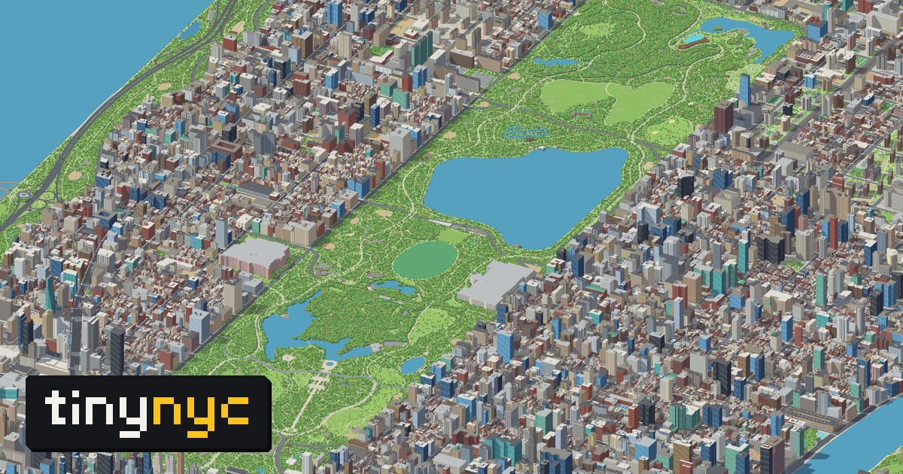
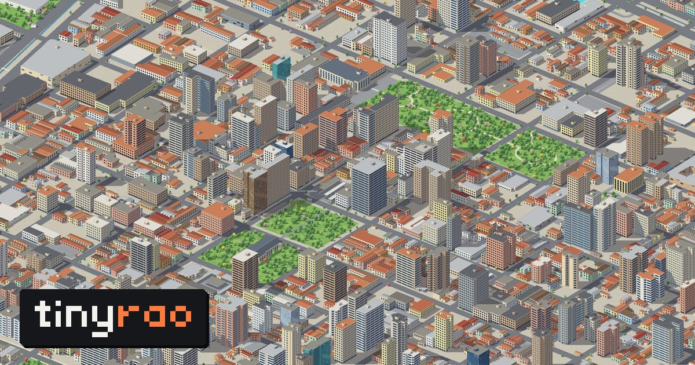
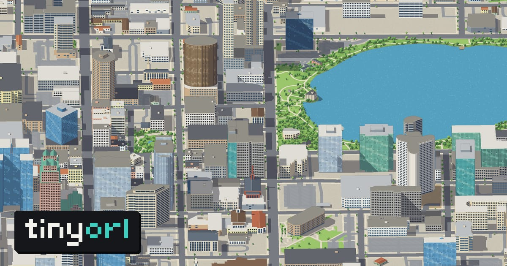
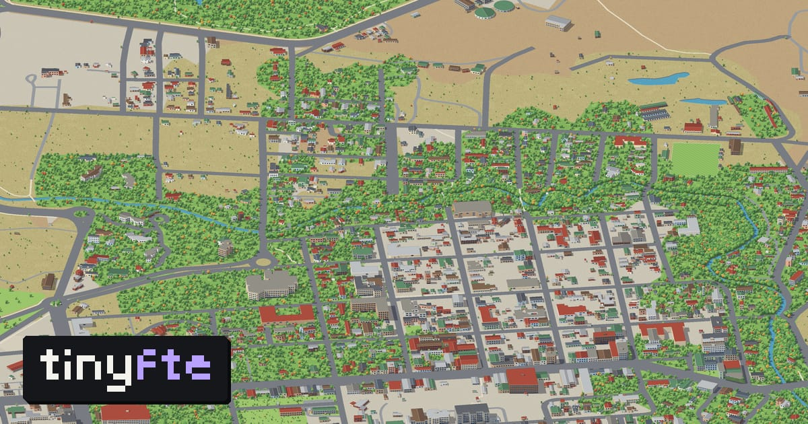
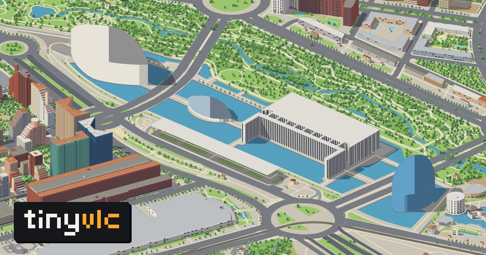
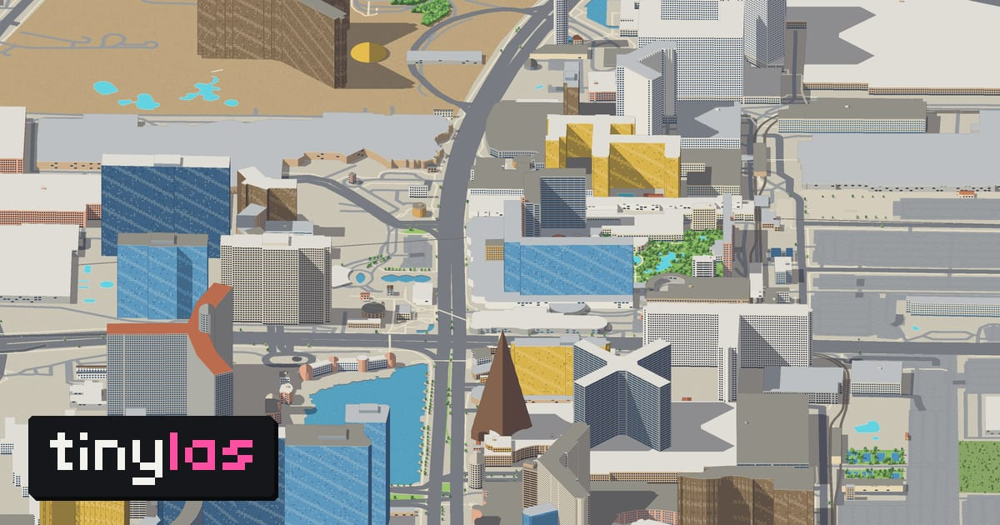
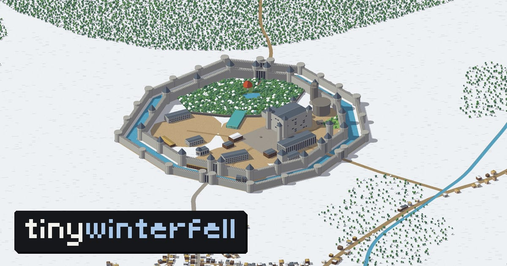
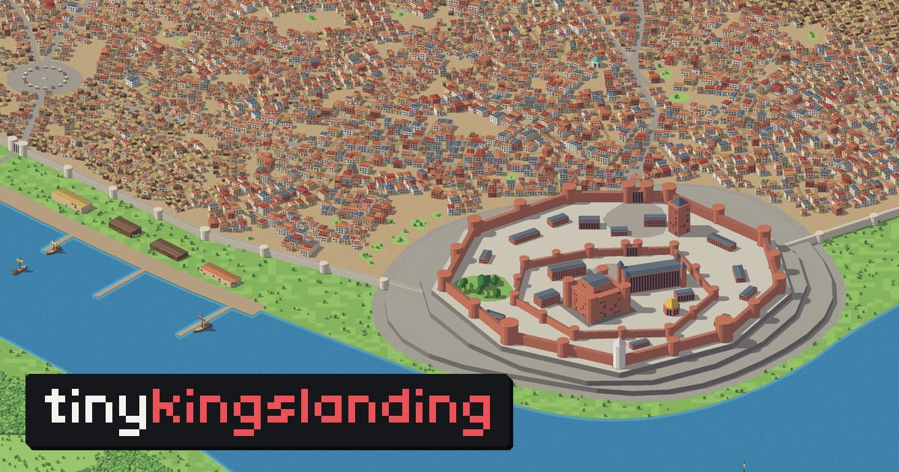
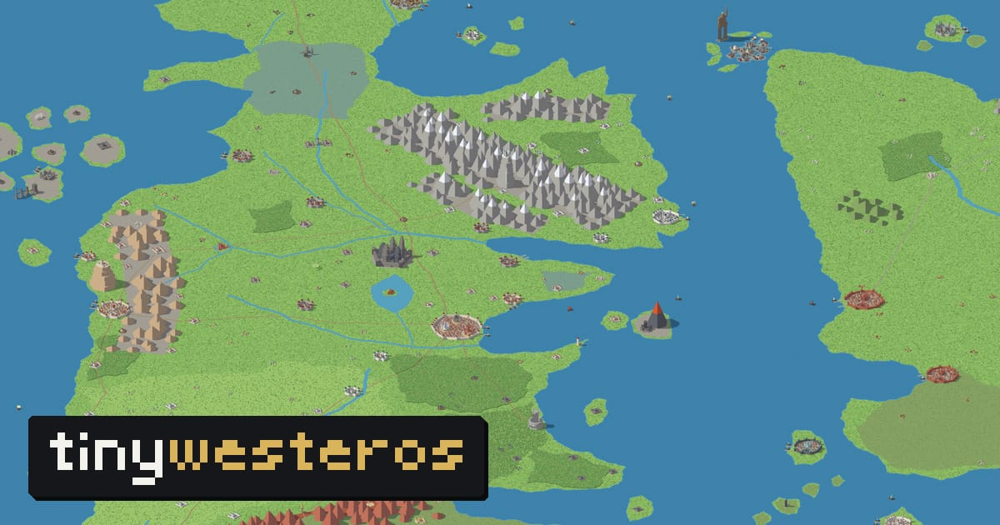

# tinyworlds

Whole cities, pocket-sized: each one drawn as an isometric pixel-art map you can pan, zoom and
search, every building at its height.

| tinynyc · New York | tinyrao · Ribeirão Preto | tinyorl · Orlando |
| --- | --- | --- |
|  |  |  |

| tinyfte · El Calafate | tinyvlc · Valencia |
| --- | --- |
|  |  |

| tinylas · Las Vegas | tinywinterfell | tinykingslanding |
| --- | --- | --- |
|  |  |  |

| tinywesteros |
| --- |
|  |

Nothing is drawn by hand and no image model is involved. The maps are rendered procedurally from
open data by a software rasterizer written for the purpose: building footprints and heights,
streets, parks, water and trees go in; a pyramid of pixel-art tiles comes out. A full city takes
a few minutes to render on a desktop machine.

- **tinynyc**: all five boroughs, 1.37 million buildings at their surveyed heights, the 2015
  street-tree census, bridges with raised decks and cables, ferries on their real routes.
- **tinyrao**: Ribeirão Preto (São Paulo, Brazil). Almost no building there has a mapped height,
  so heights are read from a satellite-derived raster and calibrated against the buildings whose
  floors are mapped; around the city, the cane fields.
- **tinyorl**: Orlando, Florida: everything built up from Walt Disney World to Winter Park, with
  downtown and Lake Eola, the lakes, the airport and the resorts.
- **tinyfte**: El Calafate, Patagonia: the town on the shore of Lago Argentino, Laguna Nimez and
  the steppe around it.
- **tinyvlc**: Valencia, Spain: the old town, the Turia gardens, the City of Arts and Sciences,
  the port and the beaches, with the city's street trees one by one.
- **tinylas**: Las Vegas: the Strip and its resorts, downtown, the airport and the desert valley.

Three more are imagined places, generated by code with no map data at all, as a fan-made tribute:
**tinywinterfell**, **tinykingslanding** and **tinywesteros**, the whole known world from beyond
the Wall to Asshai as one toy-scale diorama (unofficial; places from *A Song of Ice and Fire*
© George R. R. Martin).

## Layout

| Path | What |
|------|------|
| `tinyworlds-pipeline/` | TypeScript CLI: downloads the data, builds the scene, renders the tiles and indexes |
| `tinyworlds-frontend/` | Next.js 16 static site: the map viewer (one build per city) and the front page |
| `tinyworlds-api/` | NestJS + GraphQL + Prisma: donations and per-city funding milestones |
| `deploy/` | nginx config and the deploy script |

## Setup

Requires Node 22+ and npm. About 1.5 GB of disk per large city for raw data, scene and tiles.

```bash
# 1. make a map (≈ 5 minutes for New York, ≈ 2.5 for Ribeirão Preto, after the downloads)
cd tinyworlds-pipeline
npm install
npm run all -- --city tinynyc     # fetch → scene → render → index, into ../tinyworlds-frontend/public/data/tinynyc

# 2. look at it
cd ../tinyworlds-frontend
npm install
NEXT_PUBLIC_WORLD=tinynyc npm run dev      # http://localhost:3000
```

The API is only needed for the donation milestones:

```bash
cd tinyworlds-api
npm install
cp .env.example .env               # fill in Stripe test keys
docker compose up -d               # local Postgres
npx prisma migrate deploy && npm run seed
npm run start:dev                  # http://localhost:4000/api/graphql
```

Or `./dev.sh [world]` for all three in tmux.

### Environment

No secrets are needed to render or view a map. Each sub-project has a `.env.example`; the main
variables:

| Variable | Where | Default | Meaning |
|----------|-------|---------|---------|
| `TINY_CITY` / `--city` | pipeline | `tinynyc` | which city to draw |
| `OVERTURE_RELEASE` | pipeline | `2026-10-21.0` | Overture Maps release to read |
| `NEXT_PUBLIC_WORLD` | frontend | `tinynyc` | which world to build, or `home` for the front page |
| `NEXT_PUBLIC_BASE_PATH` | frontend | empty | sub-path the build is served under (`/tinynyc`) |
| `NEXT_PUBLIC_API_URL` | frontend | unset | the API's GraphQL endpoint; unset = no milestones |
| `DATABASE_URL`, `STRIPE_*` | api | — | see `tinyworlds-api/.env.example` |

## Adding a city

A city is one definition file in the pipeline (`src/cities/<id>.ts`: where it is, which way its
street grid runs, what counts as its limits, what its buildings look like) and one in the viewer
(`src/worlds/<id>.ts`: its name and words). See the `CLAUDE.md` in each sub-project.

Cities get built as donations reach US$100 for them, the most funded first; you can also open a
pull request with one.

## Deploy

The site is static files behind a stock nginx; the API is one container.

```bash
cp deploy/.env.example deploy/.env    # where your server is; never committed
deploy/deploy.sh tinynyc              # build for /tinynyc, rsync the site and the tiles
deploy/deploy.sh home                 # the front page
```

See [deploy/README.md](deploy/README.md).

## Contact

Questions, ideas, a city you want to see: me@nihey.org

## Credits

Map data © OpenStreetMap contributors and the Overture Maps Foundation. New York: boundaries,
neighbourhoods and street trees from NYC Open Data. Ribeirão Preto: building heights from Google
Open Buildings 2.5D Temporal (CC BY 4.0), planning sub-sectors from IBGE (Censo 2022).

The idea of a city redrawn tile by tile as isometric pixel art comes from
[tinyrj](https://tinyrj.com/) and isometric.nyc; this is an independent, procedural take on it.

## Licence

Code: [MIT](LICENSE). The rendered tiles are produced from open data and carry its attribution
requirements (see Credits).
